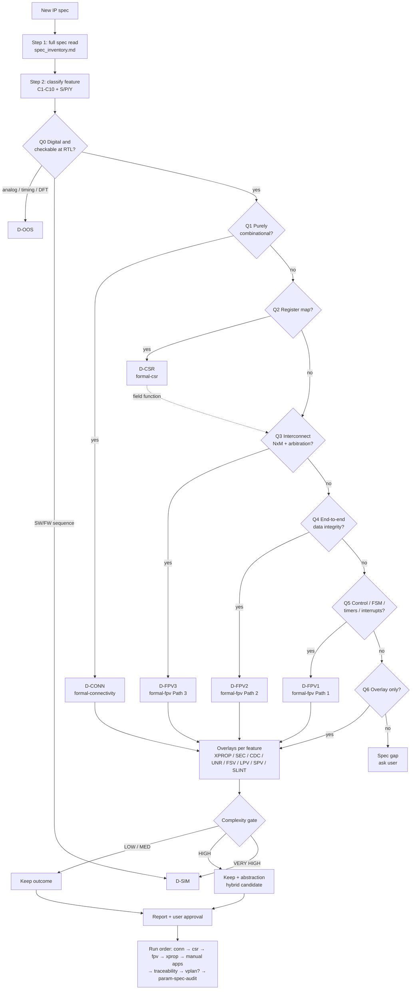

# Formal Methodology Decision Tree — Diagram

- Visual companion of `decision_tree.md` (that file is authoritative).
- Walk once PER FEATURE; first YES in Q0–Q5 decides the PRIMARY outcome; overlays then apply to every feature.
- PNG: `decision_tree.png` (source `decision_tree.dot`; regenerate with `dot -Tpng -Gdpi=130 decision_tree.dot -o decision_tree.png`).
- Mermaid renders locally (VS Code / Confluence Mermaid macro); do not send to external renderers.

## 1. Tree (text)

```text
NEW IP SPEC
└── Step 1: read full spec → spec_inventory.md (features, cited §)
    └── Step 2: classify each feature (C1–C10 + tags S/P/Y)
        └── FOR EACH FEATURE
            ├── Q0  Digital & checkable at RTL from spec?
            │   ├── NO, analog / physical timing / ATE-DFT ........ D-OOS (or D-SIM with AMS model)
            │   ├── NO, SW/FW-driven sequence, no bounded property  D-SIM
            │   └── YES ↓
            ├── Q1  Purely combinational routing / glue? (C1)
            │   ├── YES ............................................ D-CONN  → formal-connectivity
            │   │       (positive + default + priority + negative rows)
            │   └── NO ↓
            ├── Q2  Register map to sign off? (C2)
            │   ├── YES ............................................ D-CSR   → formal-csr
            │   │       (field functional effect continues at Q3–Q5)
            │   └── NO ↓
            ├── Q3  Interconnect: N initiators × M targets + arbitration? (C5)
            │   ├── YES ............................................ D-FPV3  → formal-fpv Path 3
            │   │       (ABVIP + per-initiator scoreboard tasks + SVA)
            │   └── NO ↓
            ├── Q4  End-to-end data integrity (store / transform)? (C4)
            │   ├── YES ............................................ D-FPV2  → formal-fpv Path 2
            │   │       (wrapper + ABVIP + models + scoreboard + SVA)
            │   └── NO ↓
            ├── Q5  Control: FSM / timers / interrupts / status? (C3)
            │   ├── YES ............................................ D-FPV1  → formal-fpv Path 1
            │   │       (bind-file SVA, bounded liveness from spec)
            │   └── NO ↓
            └── Q6  Nothing matched
                ├── overlay-only feature ........................... overlays decide
                └── otherwise ...................................... SPEC GAP → spec_gaps.md, ask user
        ├── OVERLAYS (every feature, non-exclusive)
        │   ├── C6 X-sensitive ......... D-XPROP → formal-xprop
        │   ├── C7 config equivalence .. D-SEC   (manual)
        │   ├── C8 async clocks ........ D-CDC   (manual, separate flow)
        │   ├── C9 unreachability ...... D-UNR   (manual, needs sim coverage DB)
        │   ├── S  safety .............. D-FSV   (manual)
        │   ├── P  low power ........... D-LPV   (manual)
        │   ├── Y  security path ....... D-SPV   (manual)
        │   └── any IP (optional) ...... D-SLINT (manual pre-flight)
        └── COMPLEXITY GATE (complexity_rubric.md)
            ├── LOW / MEDIUM ........... keep outcome
            ├── HIGH ................... keep + abstraction plan, "hybrid candidate"
            └── VERY HIGH / override ... D-SIM or hybrid (reason cited from spec)
    └── Step 5: report <ip>_formal_methodology.md → Step 6: user approval
        └── RUN ORDER
            ├── 0 D-SLINT (optional)
            ├── 1 formal-connectivity
            ├── 2 formal-csr
            ├── 3 formal-fpv (Path 1 / 2 / 3)
            ├── 4 formal-xprop
            ├── 5 manual: SEC → CDC → FSV → LPV → SPV → UNR
            ├── 6 formal-traceability
            ├── 7 formal-vplan (NOW / LATER / NOT NEEDED)
            └── 8 param-spec-audit (always last)
            (D-SIM items → simulation owner in parallel)
```

## 2. Tree (Mermaid)


